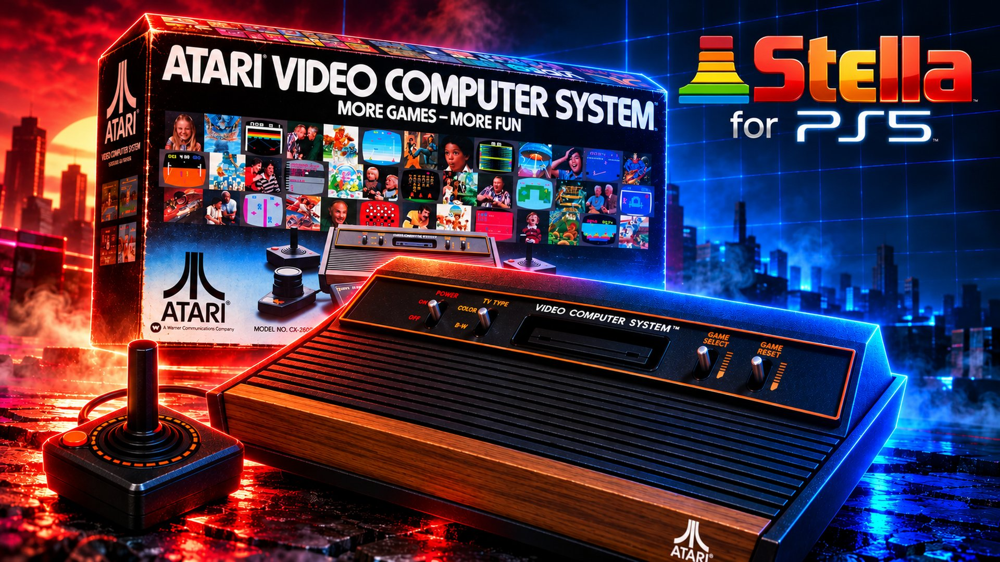

# Stella PS5

[](ps5/app/sce_sys/background-source.png)

[Stella](https://stella-emu.github.io/) -- the Atari 2600 emulator -- running on a jailbroken PS5 as a **native
home-screen app** with its own icon and background, on the 3D game shelf of NES FCEUmm PS5. The same app also plays
the Atari 5200, the Atari 7800 and the Atari Lynx, each with its own core:

| System | Core | Files | BIOS (in `/data/stella/bios/`) |
|---|---|---|---|
| Atari 2600 (VCS) | **Stella 7.0** | `.a26` `.bin` `.rom` | none |
| Atari 5200 | a5200 | `.a52` `.bin` | `5200.rom` optional: a free replacement (Altirra's) is built in |
| Atari 7800 | ProSystem | `.a78` `.bin` | none (ProSystem gets an empty folder of its own, so it never loads a 7800 BIOS) |
| Atari Lynx | Gearlynx | `.lnx` `.lyx` `.o` | **`lynxboot.img` needed** (512 bytes) |

Games can also be inside a `.zip` or a `.7z` (see [Zip and 7-Zip archives](#zip-and-7-zip-archives)), and can be
played from a NAS or PC on your network (SMB or NFS shares: see [Network shares](#network-shares-smb-and-nfs)). No
game and no BIOS is included.

**Inside a game, to open the pause menu press L3 + R3.**

The PS5 layer follows the layout of PS5SX2 (the PCSX2 port) and of NES FCEUmm PS5, Beetle PCE PS5, Genesis Plus GX
PS5 and Snes9x PS5, the ports it comes from:

- `ps5/coreorbis` holds `main-boot.cpp`, the `orbis-shims/` and `include-orbis/`;
- `ps5/frontend` holds the user interface, the 3D game shelf and the glue to the four cores;
- `ps5/third_party/cores` holds the 5200, 7800 and Lynx cores ([their README](ps5/third_party/cores/README.md));
- `ps5/proto/native` builds and signs `eboot.bin`;
- `ps5/installer` is the installer and helper payload.

Everything outside `ps5/` is **Stella 7.0** (tag `7.0`, commit `d55b1aec0d067a4c901a6dcdf81cb8f579685659`), as the
repository's first commit has it, apart from this README (Stella's own is [README-Stella.md](README-Stella.md)) and
**three small changes** in Stella's libretro port, each marked `Stella PS5:` (see [Building](#building)). The emulator (`src/emucore`,
`src/common`) and its libretro port (`src/os/libretro`) are compiled from the port's own source list. The frontend
drives the cores through their libretro interface and plays the part RetroArch plays on a PC.

> **Status (1.0):** builds with the ps5-payload-dev SDK into a signed native app (`eboot.bin`) and its payload, and
> passes 571 host tests (with netfs's 235 checks, the 7z reader's 43, the NFS backend's and the tabs' unit tests), which
> run the same code -- the four cores included -- on Linux
> with the PS5 calls simulated: test programs written for this port (a 2600 game that shows on screen which inputs
> and switches it sees, a 5200, a 7800 and a Lynx program) are played through the whole chain -- the shelf, the pad,
> the core, the video and sound output --, from zips, `.7z` archives and a simulated network share. **It has not been
> run on a PS5 yet** (see [Known limitations](#known-limitations) for what only a console can confirm). If something
> fails, the logs in `/data/stella/logs/` say where.

## How it works

The PS5 gives the controller only to the app in front, so Stella PS5 runs as a native app opened from its icon, and
the payload you send is its installer:

| Piece | What it is | In PS5SX2 |
|---|---|---|
| `eboot.bin` in `/data/homebrew/PPSA99927/` | **the emulators**, a native app opened from its icon | PCSX2 (PPSA99203) |
| `sce_module/libc.prx` | the C runtime module every native app carries | the same file, byte for byte |
| `StellaPS5.elf` (payload) | the **installer**: installs or updates the app, then stays running as the **helper** | PS5SX2Installer.elf + PS5SX2Helper.elf |

When it opens, the app asks the helper to let it out of its sandbox; without that an app sees neither `/data` nor
USB drives. The request is the one PS5SX2 makes:

- **Who is asked, in order:** the Stella helper (127.0.0.1:9095), then etaHEN (9028) and the daemon on port 9069.
- **If nobody answers:** the app carries a copy of the helper (`StellaPS5-helper.elf`), sends it to the ELF loader
  (127.0.0.1:9021) and asks again. So the icon keeps working after a reboot, as long as the ELF loader runs.
- **What the helper allows:** only title PPSA99927. It gives the process the system's root folder and uid 0, as elfldr
  does for payloads. No other app is touched.

Stella PS5 only uses `/data/stella/`, `/data/homebrew/PPSA99927/` (or the folder ShadowMount+ runs it from, see
[Updates](#updates)) and its own `/user/appmeta/PPSA99927/`. It sits next to the other ports (NES FCEUmm PS5
PPSA99013, Beetle PCE PS5 PPSA99925, Media Player Classic PS5 PPSA99015, Snes9x PS5, Genesis Plus GX PS5, PS5SX2...)
without touching them.

## Versions

Every release carries its version in the file name: `StellaPS5-v1.0.elf`, `StellaPS5-v1.0-PPSA99927.zip` (the app
folder, for the updater and the homebrew catalog) and `stella-ps5-v1.0-src.zip` (`make dist`). In this README,
"`StellaPS5.elf`" always means the current release's ELF.

**1.0:** the first release: Stella 7.0 for the 2600 with its palettes, TV effects, phosphor and pixel aspect, the
console's switches on the pad and in the pause menu; a5200, ProSystem and Gearlynx for the 5200, 7800 and Lynx, in
the same app, a shelf tab each; everything the other ports' 1.x have (covers in the background, CRT shaders, network
shares, 7-Zip, five languages, the debug logs setting, the crash log), and the updater with Media Player Classic PS5
1.5's ShadowMount+ fix.

## Updates

The app updates itself from this repository's GitHub releases, as Beetle PCE PS5 and FBNeo PS5 do:

- **Settings, SYSTEM, Updates** shows the version you have and what to do: *Check now*, *Install 1.1 (12 MB)*, the
  download and install progress, then *Installed: restart* (Cross opens the new version).
- Once a day, when the app starts, it checks by itself; when a newer version is out, a notification says so. Nothing
  is installed without you choosing *Install*.
- The helper does the work, with its own HTTPS (Mbed TLS, certificates checked). It asks
  `api.github.com/repos/MisterTemaki/stellaPS5/releases/latest` for the newest release and takes its asset
  `StellaPS5-v<version>-PPSA99927.zip`.
- The zip is checked before anything is written: its size and SHA-256 against what GitHub gives (a release whose zip
  GitHub gives no SHA-256 for is not downloaded at all, as in Media Player Classic PS5 1.5), then every file
  against the zip's own list (`PPSA99927/manifest.sha256`). Each file is written beside the old one, then all are put
  in place with `eboot.bin` last; files the new version no longer has are removed, and the home screen's copy of the
  art is refreshed. If anything fails before that, nothing has changed.
- **The install journal** (Media Player Classic PS5 1.5's): while the files are put in place, `update.journal` in the
  app folder lists each one, its old copy kept as `<name>.old.<n>` until the last one is in. If a rename fails, the
  files already moved are put back; if the install is cut off (power, a crash), the helper puts the old version back
  the next time it starts (`helper.log` says so; a notification only when a file couldn't be put back). If the
  journal itself is damaged, it is left alone and a notification says to send the payload again: `StellaPS5.elf` then
  writes every file again from its own copy and removes the update's leftovers. Games, saves and settings (`/data/stella/`)
  aren't touched.
- **With ShadowMount+** (Media Player Classic PS5 1.5's fix, found by Sulfurico-One64 there). ShadowMount+ registers
  the app by mounting its folder on `/system_ex/app/PPSA99927` (nullfs), and the console runs it from there. That
  folder is wherever ShadowMount+ found the app: `/data/homebrew/PPSA99927` (where the payload installs it),
  `/data/etaHEN/games/...`, a USB or extended drive's `homebrew` folder, or an image (`.ffpkg`, `.exfat`, `.ffpfs`)
  it mounted under `/mnt/shadowmnt`. The updater (and the payload) find the mount's source and update **that**
  folder, writing **through the mount**, so the console runs the new files; `boot.log` and `helper.log` say which
  (`[update] /system_ex/app/PPSA99927 is a nullfs mount of ...`). Nothing is written where the app isn't sure it is
  the copy the console runs: every folder written has a `sce_sys/param.json` naming PPSA99927; a mount's source is
  used only when its name is whole (the system cuts it at 87 characters), otherwise the files go only through the
  mount; another layer on top of the mount (a backport's unionfs) is never written into -- the folder beneath is;
  and when the mount can't be read at all, nothing is written.
  - **The mount table is read by the helper**, not by the app (Media Player Classic PS5 1.5.1's fix): `statfs` /
    `getfsstat` are only in the SDK's `libkernel_sys`, a library for the console's system processes that a title
    can't load -- Media Player Classic PS5 1.5's app imported it and the console stopped it at launch (SIGSYS, its
    #3). Stella PS5's app asks the helper (`boot.log`: `[update] (from the helper) ...`). Without the helper's answer
    (none running, or one that doesn't know the request) the app goes by ShadowMount+'s link
    `/user/app/PPSA99927/mount.lnk`: that folder counts only when its `param.json` names PPSA99927 and its `eboot.bin`
    is the one `/system_ex/app/PPSA99927` shows (an image's folder never); without a link, or with one to another
    folder, Updates says the app can't tell which folder it runs from and nothing is written. The build checks the
    eboot: `tools/check_imports.py` fails it if it would load any module, or import any symbol, a title can't.
  - **No mount yet** (the payload autoloaded before ShadowMount+ mounted the app): the folder ShadowMount+ last
    mounted is in its link `/user/app/PPSA99927/mount.lnk`; the payload updates that folder, so **no second copy** is
    made in `/data/homebrew`. If it isn't there (a drive not connected yet), nothing is written.
  - **An image or a read-only folder:** the app can't write an update into it. **Updates says so before downloading
    anything**, in words that say what to do (update the image or folder the way you made it, with the new version's
    folder from the release's zip); the helper refuses to write there too, and the payload just says the app is
    ready (or newer) when the image holds its version or a newer one, so an autoloaded payload doesn't nag.
  - **After the restart:** Restart opens the eboot the console runs (`/app0/eboot.bin` when the app sees it, else the
    mount's, else the folder's). The next start compares the running version with the one installed: if it is still
    the old one, the app says what to do -- close the app completely (Options on its card on the home screen, Close
    Application) and open it again; if it is still old, run ShadowMount+ again from the Payload Manager (it registers
    the app again) or restart the PS5.
  - **The version on the home screen** (the app's information there) comes from ShadowMount+'s registration: it only
    changes when ShadowMount+ registers the app again. The app itself says its version on the shelf and in Settings.
- **Your autoload:** the app updated this way is newer than the ELF in your autoload. The older ELF sees that and
  leaves the app alone (its notification says so), and its helper still serves the newer app. Put the new ELF in your
  autoload when you can.

For a release, `make dist` builds the zip (`build/dist/StellaPS5-v<version>-PPSA99927.zip`, the app folder stored
without compression, with its manifest). Attach it to the GitHub release, tagged `v<version>`, next to the ELF.

## Language

Settings (Triangle on the shelf), **SYSTEM**, **Language**: **English** (the default), **Español**, **Português
(Brasil)**, **Français**, **Deutsch**. The change applies at once, to every menu and message, and is kept in
`stella-ps5.ini` (`language=0` to `4`). The logs stay in English, and so do the notifications sent by the helper.
Game names, the PS5's and the consoles' button names (Game Reset, Option 1...) and the shaders' names are not
translated.

## Requirements

- A jailbroken PS5 with **kstuff** (or kstuff-lite) and an **ELF loader** on port 9021: elfldr, etaHEN, or the one
  PS5 Payload Manager uses.
- **ShadowMountPlus**, so the icon appears on the home screen (the same one PS5SX2 uses).
- Your own games; for Lynx games, the Lynx boot ROM `lynxboot.img`; for the few 5200 games the built-in BIOS doesn't
  run, the 5200's `5200.rom`.

## Install and play

1. **Send `StellaPS5.elf`** with PS5 Payload Manager, or from a PC on the same network:
   ```sh
   nc -q0 PS5_IP 9021 < StellaPS5-v1.0.elf
   ```
   It installs the app in `/data/homebrew/PPSA99927/` (`eboot.bin`, `sce_module/libc.prx`, `param.json`, the icon,
   the backgrounds and `licenses/`: the GPL, the LGPL 2.1 and `NOTICES.txt`, what is in the app and under which terms), shows **"Stella PS5 1.0 installed. Open it from the Stella PS5 icon on the home screen."**
   and stays running as the helper.
2. **Open the Stella PS5 icon.** The game shelf appears and the controller works.
3. **Copy your games** to their system's folder, over FTP for example. The app makes the folders on its first start:

   | System | Games in | Your covers in |
   |---|---|---|
   | Atari 2600 | `/data/stella/roms/Atari2600` | `/data/stella/covers/Atari2600` |
   | Atari 5200 | `/data/stella/roms/Atari5200` | `/data/stella/covers/Atari5200` |
   | Atari 7800 | `/data/stella/roms/Atari7800` | `/data/stella/covers/Atari7800` |
   | Atari Lynx | `/data/stella/roms/AtariLynx` | `/data/stella/covers/AtariLynx` |

   On a USB drive the same layout goes under `stella/roms` (`stella/roms/Atari2600`...). Subfolders are fine
   (`roms/Atari2600/Activision/`).
4. **BIOS files** go to `/data/stella/bios/`: `lynxboot.img` for the Lynx (a Lynx game started without it says on
   the screen which file is missing and where it goes; nothing starts); `5200.rom` for the 5200 if you have it (used
   when it is there; without it a5200 runs Altirra's free 5200 BIOS, and a 5200 game started without it says so).

**Which system a file is:** its extension when it says (`.a26`, `.a52`, `.a78`, `.lnx`, `.lyx`, `.o`). A `.bin` or
`.rom` is the system of the folder it is in or of one of the two folders above it (`roms/Atari5200/game.bin` and
`roms/Atari5200/Homebrew/2024/game.bin` are 5200 games; a folder whose name has `2600`, `5200`, `7800`, `Lynx` or is
`VCS`), else the system whose game table knows its CRC32, else the 2600. A 7800 `.bin` without its `.a78` header plays from
`roms/Atari7800`.

**Files that aren't games** are refused before the core sees them, with a message naming the file: a 2600 image
under 32 bytes, a 7800 file too small for a cartridge or whose `.a78` header names a cartridge type its size can't be
(Absolute, Activision, Souper, bank-switched...), a 7800 `.bin` over 64 KiB not in 16 KiB banks, and a file larger
than its system's games (2600 and 5200: 512 KiB; 7800 and Lynx: 2 MiB). A file the 2600 runs but that never
shows a picture says so on the screen after a few seconds (it may be another system's game).

Tip: put `StellaPS5.elf` in your autoload, as PS5SX2 recommends for its payloads.

**Updating by hand:** send the new `StellaPS5.elf` once. It compares every app file with the copy it carries and
rewrites only what changed (each file to a temporary file, then renamed, `eboot.bin` last). A second copy sent while
the helper is already running only installs and exits. (The updater does the same from the app: see
[Updates](#updates).)

**If "Stella PS5 has no access to /data" appears:** no helper answered and the ELF loader wasn't running. Send
`StellaPS5.elf` and open the icon again.

### If the app doesn't open

If the console stops the app at launch ("Error in game PPSA99927", with a signal such as 12, SIGSYS), please report it
(with `/data/stella/logs/boot.log` and `installer.log` if they are there: turn on Settings, SYSTEM, Debug logs first
if the app opened before). Stella PS5's eboot loads only the system modules a title may load
(`tools/check_imports.py` checks every build: the cause of Media Player Classic PS5 1.5's crash at launch, its #3,
can't come back unnoticed), but only a PS5 can confirm it opens. To put another version in place:
- **Send that version's payload** (`StellaPS5-v<version>.elf`) and put it in your autoload. A newer payload writes
  itself over the installed app, into the folder ShadowMount+ runs it from; close the app if it is open, then open it
  again.
- **Going back to an older version:** a payload never writes itself over a newer one ("a newer version is installed
  ... left it as it is"), so first move or delete the app's folder (`/data/homebrew/PPSA99927`, or the one ShadowMount+
  runs it from), then send the older payload: it installs afresh. If the app is in an image, put the older version's
  folder in the image instead.
- **With ShadowMount+** (what Sulfurico-One64 did for Media Player Classic PS5; it works for any version): move the app's folder out of the place ShadowMount+
  scans, uninstall the app from the home screen, let ShadowMount+ run again (from the Payload Manager) so it forgets
  it, then put the folder of the version you want back (from that version's release zip, or with its payload) and run
  ShadowMount+ again: it registers the app from that folder.

| Folder | Contents |
|---|---|
| `/data/stella/roms/<system>` | your games: `Atari2600`, `Atari5200`, `Atari7800`, `AtariLynx` |
| `/data/stella/bios` | `lynxboot.img`, `5200.rom` |
| `/data/stella/saves` | the games' own saves, one folder per system: a Lynx cartridge's EEPROM in `saves/AtariLynx/<game>.srm` (the other cores keep none of their own). Written within 3 seconds of a change and when the game closes |
| `/data/stella/states` | save states, one folder per system: `states/Atari2600/<game>.state1` to `.state10` |
| `/data/stella/covers/<system>` | downloaded covers and your own; `covers/` itself keeps `wanted.txt` and `crc-cache.txt` |
| `/data/stella/logs` | `boot.log` (the app), `installer.log` (installer/helper), `helper.log`, and the previous session's `.prev.log` files |
| `/data/stella/stella-ps5.ini` | the settings |
| `/data/stella/shares.txt` | the network shares |

### The home-screen app

```
/data/homebrew/PPSA99927/
  eboot.bin              the four emulators and the frontend (a native app, signed as PS5SX2's is), with the helper inside
  sce_module/libc.prx    the native app's C runtime (the same as PS5SX2's and ps5-native-app-boilerplate's)
  sce_sys/param.json     title "Stella PS5", ID PPSA99927, version 01.000.000
  sce_sys/icon0.png      the icon (512x512)
  sce_sys/pic0.dds       the home-screen background while the icon is selected (3840x2160, BC7)
  sce_sys/pic1.dds       the launch background (the same image)
```

The background -- the large image behind the icon when Stella PS5 is selected on the home screen, and the launch
screen -- is the project's key art, chosen by its author: `ps5/app/sce_sys/background-source.png` (3840x2160),
encoded to `pic0.dds`/`pic1.dds` as BC7 by `ps5/tools/make_art.py` (bc7enc_rdo, as ps5-native-app-boilerplate's
`tools/prepare-assets.sh --background` does; `make art BC7ENC=<bc7enc>`). The icon is the project's art too, chosen
by its author: `ps5/app/sce_sys/icon-source.png` (512x512); `icon0.png` is the same file. To change them, replace
`icon0.png` and `icon-source.png` (512x512 PNG) or `background-source.png` (16:9; then `make art`, which only reads
it), and rebuild.

**Home-screen art:** ShadowMountPlus copies the art in `sce_sys` to `/user/appmeta/PPSA99927/` when it registers the
title. The installer keeps that folder current on every update; if the title was registered before the art changed,
register it again once (select **Stella PS5** on the home screen, **OPTIONS**, **Delete** -- your games, saves and
covers in `/data/stella/` stay --, then send `StellaPS5.elf` again).

## The game shelf and covers

The start screen is a 3D shelf of game covers, with the author's line under the wordmark:
**github.com/MisterTemaki**.

- **All your games, in tabs:** the shelf gathers the games in `/data/stella/roms`, on USB drives (`stella/roms`) and on
  network shares, subfolders included, sorted by name. A bar at the top keeps them apart: **Internal** (the
  console's drive), **USB** (only while a game is on a USB drive) and **Network**. **L1 / R1** go round them; inside
  one, **Up / Down** go through **All games** and one tab per system that has games there (**Atari 2600**, **Atari
  5200**, **Atari 7800**, **Atari Lynx**). The shelf remembers the last tabs.
- **Names:** a 2600 game is named by **Stella's own database** (its properties: the name, maker and year, from the
  ROM's MD5) when it knows the game, else by No-Intro's name; the other systems by No-Intro's names. A game is
  recognised by its file name or, when that doesn't match, by its CRC32, in a table of 1,994 No-Intro names built
  into the app (`ps5/frontend/data/nointro.tsv`, from libretro-database's DATs of 2026-10-07: 890 Atari 2600, 150
  5200, 337 7800 and 617 Lynx entries); a 7800 or Lynx game's CRC is taken without its header, as No-Intro's is. Loose
  names (`combat.a26`) are recognised too. CRCs and MD5s are cached in `covers/crc-cache.txt`, so each ROM is read
  once.
- **Automatic covers, in the background:** box art comes from
  [libretro-thumbnails](https://github.com/libretro-thumbnails) (`Atari_-_2600`, `Atari_-_5200`, `Atari_-_7800`,
  `Atari_-_Lynx`, their `Named_Boxarts`) by the game's No-Intro name, over HTTPS. The **helper** downloads them while
  you use the app (the console's own HTTPS only works inside the app's sandbox), with HTTPS of its own: Mbed TLS,
  certificates checked against Mozilla's list. Each cover replaces its card as it lands. A cover the server doesn't
  have is marked (`.missing`) and looked for again after 30 days; **Square** forces a new try. Without a network
  nothing is tried and the shelf works the same.
- **Your own covers:** a `.png` or `.jpg` named after the ROM file, in `/data/stella/covers/<system>/`, takes priority.
- **No cover:** the game gets a card with its title, its system and that system's emblem, drawn for this port: a
  one-button joystick (2600), a keypad controller (5200), a two-button joystick (7800), a handheld (Lynx).
- **Turning downloads off:** Settings, "Download covers".

To fill the shelf yourself, download each system's `master.zip` from libretro-thumbnails (`Atari_-_2600` and so on)
on a PC and copy the `.png` files of its `Named_Boxarts` folder to that system's `covers/` folder.

## Network shares (SMB and NFS)

Games can be read from a Windows, Samba, NAS or router share: **Settings (Triangle on the shelf) > LIBRARY > Network
shares > Add a share**, with the on-screen keyboard and **Test connection** -- NES FCEUmm PS5 1.1's network shares,
by [thatboialex](https://github.com/thatboialex) in Snes9x PS5 (pull request
[#3](https://github.com/MisterTemaki/snes9xPS5/pull/3)). Or edit `/data/stella/shares.txt`, one address per line (up
to 8):

```
smb://192.168.1.50/games/atari
smb://jason@192.168.1.50/games/atari?password=secret
nfs://192.168.1.50/export/atari
```

- The share's games appear on the **Network** tab as soon as it has connected; **Square** there scans again. The
  system folders work there too (`Atari2600/`...).
- Games are **read whole** into memory when they start (an Atari game is a few KiB to 1 MiB): nothing is read from the
  share while a game runs. A power cycle starts the game again from memory.
- A share is read-only: saves, states, covers, settings and the BIOS files stay on the console.
- Network games are first named from their file names; a background pass then reads each once to name it by its
  checksum, and the answer is remembered.
- SMB uses libsmb2 and NFS uses libnfs (LGPL-2.1-or-later), in `ps5/third_party/` with their licence notices.

## Zip and 7-Zip archives

A game of any of the four systems can sit inside a `.zip` or a `.7z`. The game's system comes from the file inside;
the first game in the archive's order is the game (a text file next to it is skipped). It is unpacked into memory
when it starts, and once on the shelf to name it (its MD5 is Stella's database key, which the archive doesn't keep).

- **7-Zip methods:** LZMA, LZMA2, PPMd, with the BCJ / BCJ2 / ARM / Delta filters, and stored files -- not BZip2,
  Deflate, Zstandard or encrypted archives (the screen says why such an archive can't start).
- **Limits:** a game inside an archive is at most its system's largest (2600 and 5200: 512 KiB; 7800 and Lynx:
  2 MiB, header included; a bigger one is refused with a message saying it is larger than any game of its system); a "solid" block over 64 MiB is refused; an archive listing more than 65,536 files is refused.
- The 7z decoder is the [LZMA SDK](https://www.7-zip.org/sdk.html)'s C decoder (7-Zip 26.05, public domain).

## Controls

**Inside a game, to open the pause menu press L3 + R3.**

**On the shelf**

| Button | Does |
|---|---|
| Left / Right (D-pad or stick) | change game (hold to speed up) |
| Up / Down | change system tab (All games, Atari 2600, ...) |
| L1 / R1 | storage tab (Internal, USB, Network) |
| L2 / R2 | skip 10 games |
| Cross | play |
| Triangle | settings |
| Square | download this game's cover again; on the Network tab: scan the shares again |
| OPTIONS | quit Stella PS5 (asks first) |

**In a game**, each system has its own layout. Every button can be moved, system by system (Settings, **CONTROLS**).

**Atari 2600** -- the joystick, and the console's switches:

| PS5 | Atari 2600 |
|---|---|
| D-pad or left stick | joystick |
| Cross (and Square) | fire |
| Circle | Booster Grip trigger / Genesis pad's button C |
| OPTIONS | **Game Reset** (held while you hold it) |
| touchpad click | **Game Select** |
| L1 | **left difficulty** switch: each press flips it between A and B |
| R1 | **right difficulty** switch, the same |
| Triangle | **TV type** switch: colour / B&W, each press flips it |

The switches stay where you put them, as on the console; the pause menu shows where each one is and flips it too
(and has Game Reset and Game Select). The console starts with both difficulties on B and the TV type on colour, as
Stella sets them (or as its database says for the game).

Only the **joystick** is played with the pad in 1.0. A game that needs **paddles, driving controllers, keypads, a
trackball, a mouse or a light gun** (Stella tells from its database and its detection) shows a message naming the
controller when it starts -- "This game needs paddles, which aren't supported yet." -- and starts all the same.

**Atari 5200** -- the analog joystick and the keypad:

| PS5 | Atari 5200 |
|---|---|
| left stick | the analog joystick, **proportional** (as the 5200's) |
| D-pad | the joystick pushed all the way |
| Cross / Circle | fire 1 (bottom) / fire 2 (top) |
| OPTIONS | Start |
| touchpad click | Pause |
| right stick | keypad 1 to 9, around 5 as on the controller |
| R3 / R1 | keypad 5 / keypad 0 |
| Square / Triangle | keypad * / # |
| L1 | a5200's **keypad on the screen** (the D-pad picks a key, Fire 1 presses it, L1 hides it) |

Reset is in the pause menu. Settings has a5200's frame blending (for flicker), its controller hack (the right stick
as the second joystick for Robotron: 2084 and Space Dungeon, or swapped ports for Wizard of Wor) and its
high-fidelity POKEY.

**Atari 7800:**

| PS5 | Atari 7800 |
|---|---|
| D-pad or left stick | joystick |
| Cross (and Square) / Circle | button 1 (left) / button 2 (right) |
| OPTIONS | Pause |
| touchpad click | Select |
| Triangle | Reset |
| L1 / R1 | left / right **difficulty** switch, each press flips it (left starts on B, right on A, as ProSystem's) |

**Atari Lynx:**

| PS5 | Atari Lynx |
|---|---|
| D-pad or left stick | D-pad |
| Circle (and Triangle) | A |
| Cross (and Square) | B |
| L1 / R1 | Option 1 / Option 2 |
| OPTIONS | Pause |

Games made to hold the Lynx sideways are turned by Gearlynx's database; Settings, **Screen rotation**, turns any game.

**Everywhere:**

| Combination | Does |
|---|---|
| L3 + R3 | pause menu: save / load state, slot, the console's switches and buttons, settings, reset, power cycle, back to the list, quit |
| L2 + Up / Down | save / load the state in the current slot |
| L2 + Left / Right | change slot (1-10) |
| hold R2 | fast forward |
| hold L2 + R2 | rewind |

**Player 2** is the second signed-in user's controller (the 2600's and 7800's right joystick, the 5200's second
controller), as on the other ports (the host tests check it on the 2600).

## Settings

Triangle on the shelf, or "Settings" in the pause menu:

- **Video:** **shader** (see [CRT shaders](#crt-shaders); CRT Easymode style by default), screen size (fit to screen,
  integer scale, stretch), **aspect ratio** (each system's own -- Stella's pixel aspect for the 2600 --, 4:3, 16:9),
  smooth picture and scanlines (with the shader Off), FPS counter.
- **Audio:** sound, volume.
- **Emulation:** fast-forward speed, rewind.
- **Atari 2600 (Stella):** **palette** (Stella's standard one, z26's, or Stella's adjustable custom one), **TV effects**
  (Stella's NTSC filter, Blargg's: composite, S-Video, RGB, badly adjusted), **phosphor** (by game -- Stella's
  database turns it on for the games that flicker --, off, on) and its **blend**, **hide the HMOVE bars** (the black
  lines many games leave on the left edge), **stereo** (by game, off, on), **TV format** (auto -- Stella's database
  and detection: NTSC at 60 Hz, PAL and SECAM at 50 Hz --, or forced, PAL-60 and NTSC-50 included).
- **Atari 5200 (a5200):** frame blending, controller hack, high-fidelity POKEY.
- **Atari 7800 (ProSystem):** dual stick (the right stick as player 2, for Robotron: 2084).
- **Atari Lynx (Gearlynx):** screen rotation (auto, none, left, right, 180 degrees).
- **Controls:** **Buttons of** (which system's buttons are listed; over a game, its system), then each of that
  system's buttons and the PS5 button that presses it (Cross, Circle, Square, Triangle, L1, R1, OPTIONS, the touchpad,
  R3, or none); **Default button layout**. Saved per system in `stella-ps5.ini` (`a26_btn_fire`, `a52_btn_fire1`...).
- **Library:** download covers; **Network shares** (not in the settings opened over a game).
- **System:** **Language**; **Debug logs** (off by default); **Updates**.

## CRT shaders

Every game starts through a CRT shader -- **CRT Easymode style** unless you pick another one. Eleven shaders are built
in (Settings, the first row; `shader=0`...`11` in `stella-ps5.ini`): Off, CRT Easymode style, crt-lottes,
crt-lottes-fast, crt-1tap, crt-2tap, crt-hyllian-fast, crt-nobody, newpixie-mini, crt-blurPi-sharp, crt-blurPi-soft,
monoCRT. They come from libretro's [slang-shaders](https://github.com/libretro/slang-shaders), rewritten for the CPU
(the PS5 build has no GPU driver for homebrew), so only single-pass shaders are fast enough. With the 2600's TV effects
on, a light shader (or Off) keeps the filter's look readable.

## Picture and sound

- 1920x1080 output through `libSceVideoOut`, flipping on vsync; 1280x720 with little video memory.
- **Atari 2600:** Stella's whole TV picture (160x228 for NTSC, 160x274 for PAL), shown at Stella's own pixel aspect
  (its double-width pixels); with the NTSC filter, Stella's 568-pixel filtered picture, the same shape on the screen.
  Stella 7.0's libretro port doesn't apply its palette option, so the frontend sets the chosen palette itself after a
  game starts.
- Sound through `libSceAudioOut` at 48 kHz, on its own thread: each core's own rate (Stella's 31,440 Hz, a5200's,
  ProSystem's, Gearlynx's) goes through a small rate control (within 0.5%) that keeps about 60 ms queued. Games at
  about 60 Hz are paced by the display; the others (PAL and SECAM 2600 games at 50 Hz, the Lynx's own rate) by the
  sound clock, so they run at their real speed.
- Fast forward runs several frames per display frame, muted; rewind keeps a snapshot every 3 frames.

## Debugging (logs and crashes)

Settings -> **SYSTEM** -> **Debug logs** (off by default; `debug_logs=1` in `stella-ps5.ini`). With it on, the app,
the installer and the helper write `boot.log`, `installer.log` and `helper.log` in `/data/stella/logs/` (and keep the
previous session's `.prev.log`): the sandbox request, the covers, the video setup, the controller, the games found and
their names, the core chosen for each game and what Stella detected (format, bankswitching, controllers, switches),
missing BIOS files, frames per second and the sound queue every minute. If the app dies on a signal, a `== CRASH ==`
block is written at the end of `boot.log` (the signal, the stage each part was in, the return addresses, which map into
`ps5/build/app/stella-pie.elf`). Send these files when reporting a problem.

## Known limitations

- **Not run on a PS5 yet.** Everything above is tested on Linux with the PS5's calls simulated. Only a console can
  confirm: that the app starts, draws and sounds right at full speed (the PS5 build is `-O3` with the same code), the
  controller's feel (the 5200 stick's range and deadzone on a DualSense, the switches), real games and real BIOS files
  (Stella's database and detection on real cartridges, the 5200 games the built-in BIOS can't run, Gearlynx with a real
  `lynxboot.img` and real `.lnx` games, their rotation), the ShadowMount+ part (the mount table, read by the helper;
  writing through `/system_ex/app`, `mount.lnk`, the same-eboot check through the mount, Restart's eboot), the updater against GitHub, covers over HTTPS from the console, and
  network shares against a real NAS.
- 2600: joystick only (no paddles, driving controllers, keypads, trackballs, mice, light guns: the message above); no
  PlusROM network games (Stella's HTTP support isn't built in); no cheats; no debugger.
- 5200: no trackball. 7800: no light gun. Lynx: no ComLynx link.
- The PS and Create buttons are not reported by `scePadReadState`, so Select / Game Select is on the touchpad.
- `.7z` archives packed with BZip2, Deflate or Zstandard, or encrypted, are refused.

## Building

Requirements: the [ps5-payload-dev SDK](https://github.com/ps5-payload-dev/sdk) v0.42 or newer, clang/lld 18, and
g++ with ASan for the tests.

```sh
export PS5_PAYLOAD_SDK=/opt/ps5-payload-sdk
cd ps5
make ps5 -j$(nproc)              # build/ps5/StellaPS5.elf (installer + helper, with the app inside); fails if the
                                 # eboot would load a module or import a symbol a title can't (tools/check_imports.py)
make send PS5_HOST=192.168.0.10  # sends it to elfldr (port 9021)
make dist                        # build/dist/StellaPS5-v<version>.elf, StellaPS5-v<version>-PPSA99927.zip, the source zip
make app                         # only build/app/PPSA99927/, to copy by hand
make test                        # Linux builds (app, installer, helper) + the 571 host tests (ASan/UBSan), with netfs's,
                                 # the NFS backend's, the tabs' and the 7z reader's unit tests
```

- **Stella** is built from its libretro port's own source list (`src/os/libretro/Makefile.common`'s `SOURCES_CXX`)
  with that port's flags (`-D__LIB_RETRO__ -DSOUND_SUPPORT`, C++20), but `libretro.cxx` itself, which
  `ps5/frontend/fe_stella.cxx` compiles inside the bridge to Stella's own API (the console's switches, the palette,
  Stella's database, what it detected). **Three changes to Stella's libretro port**, each marked `Stella PS5:`:
  - `StellaLIBRETRO::destroy()` forgets its cached pointer to the TIA's surface (`render_surface = nullptr;`,
    `src/os/libretro/StellaLIBRETRO.cxx`): without it, a second game in the same session -- going back to the list
    and starting one, or a power cycle -- drew from freed memory (RetroArch loads the core anew for every game, so it
    never meets it). The host tests found it under ASan.
  - `StellaLIBRETRO::updateVideo()` stops after 700 scanlines (`StellaLIBRETRO.cxx`): its loop waited for the TIA to
    finish a frame, which a file that never draws one (a non-2600 file run as a 2600 game) never does, and the app hung.
  - `SoundLIBRETRO::dequeue()` takes the size of the buffer it fills and stops there (`SoundLIBRETRO.hxx`, and the call
    in `StellaLIBRETRO.cxx`): such a file's long frames queued more sound than the buffer holds.
  The last two were found by fuzzing the app with odd files.
- **a5200, ProSystem, Gearlynx** (`ps5/third_party/cores`, unchanged) are built from their libretro builds' source lists, with
  their libretro entry points prefixed and every other name kept inside the core (`ps5/cores.mk`,
  [their README](ps5/third_party/cores/README.md)); `tools/check_core_symbols.py` stops the build if two parts of the
  eboot define one name.
- `eboot.bin` is a PIE linked against the SDK's stubs and static libc++, then `ps5-native-tool link` and
  `self --sign`, exactly like PS5SX2's `link-vk.sh`; `libc.prx` goes with it.
- `tools/make_gamedb.py` makes `frontend/data/nointro.tsv` from libretro-database; `tools/make_art.py` the home-screen
  background's DDS files from the key art (`make art`);
  `tools/make_notices.py` (`make notices`) the app's `licenses/` folder (`app/licenses/`, committed), which the
  payload installs and the release zip carries.
- **The source zip** (`make dist`) is `git archive` of the committed tree (`HEAD`: make it from the release's tagged
  commit), **without Stella's `test/` folder**: its bezel pictures (`test/bezels`) carry a game maker's logo and its
  profiling ROMs (`test/roms/profile`) are other people's games, neither ours to hand out. Nothing in the build or the
  tests uses that folder.

## License and credits

The whole is distributed under the **GNU General Public License, version 3 or later** ([COPYING](COPYING)): Stella,
a5200 and ProSystem are GPL-2.0-or-later and Gearlynx is GPL-3.0-or-later, so the combined program is
GPL-3.0-or-later. (For a5200 and ProSystem the "or later" rests on their emulator files' own headers, which say
"version 2 ... or any later version", and on section 9 of the GPL 2 for the files that name no version: their libretro
glue has no header and their `License.txt` is the bare GPL 2 text; see [the cores' README](ps5/third_party/cores/README.md).)
Every binary is distributed with its complete source (`make dist` makes the source zip). The app folder carries the
licences and notices in `licenses/` (`COPYING.txt`, `LGPL-2.1.txt`, `NOTICES.txt`), and so does the release zip.

- **Stella** 7.0 (Bradford W. Mott, Stephen Anthony, Thomas Jentzsch, Christian Speckner, the Stella team and
  contributors, [stella-emu.github.io](https://stella-emu.github.io/), [github.com/stella-emu/stella](https://github.com/stella-emu/stella)):
  GPL-2.0-or-later (`License.txt`, `Copyright.txt`). Its libretro port is by the Stella team and the libretro
  contributors; it includes Blargg's NTSC filter (LGPL-2.1-or-later) and nlohmann/json (MIT).
- **a5200** (the Atari800 team's emulation, its 5200 port by Alekmaul and the libretro contributors,
  [github.com/libretro/a5200](https://github.com/libretro/a5200)): GPL-2.0-or-later; Altirra's 5200 BIOS replacement
  by Avery Lee, all-permissive.
- **ProSystem** (Greg Stanton; the libretro contributors, [github.com/libretro/prosystem-libretro](https://github.com/libretro/prosystem-libretro)):
  GPL-2.0-or-later; Ron Fries' TIA and POKEY sound, LGPL-2.0; Osman Celimli's BupChip, zlib.
- **Gearlynx** (Ignacio Sanchez, [github.com/drhelius/Gearlynx](https://github.com/drhelius/Gearlynx)): GPL-3.0-or-later;
  miniz (Rich Geldreich, RAD Game Tools and Valve Software), MIT, with parts in the public domain.
- **New code in `ps5/`**: MIT (each file says so), shared with NES FCEUmm PS5, Beetle PCE PS5, Genesis Plus GX PS5,
  Snes9x PS5 and Media Player Classic PS5.
- **The home-screen idea** follows [PS5SX2](https://github.com/Swordpdf/PS5SX2) (Spyros): the PS5 layer's pattern
  (Prospero* shims, kernel toast, `/data` layout, the sandbox request, the cover prefetch, exiting through the system).
- **ps5-payload-dev SDK** (John Törnblom): toolchain, CRT, kernel access and import stubs (GPLv3+).
- **ps5-native-app-boilerplate** (BlackBearReloaded, GPL-3.0-or-later): `ps5-native-tool`, `app_crt.cpp`,
  `ps5-pie.ld` and the `libc.prx` generator, via PS5SX2 and PS5_Vulkan (mihawk-99).
- **zlib** (Jean-loup Gailly, Mark Adler) and **minizip** (Gilles Vollant): zlib license.
- **libsmb2** and **libnfs** (Ronnie Sahlberg and contributors): LGPL-2.1-or-later, linked statically for the network
  shares; their full source, with the few changes Snes9x PS5 made, is in `ps5/third_party/` and in each release's source
  zip, with everything needed to rebuild and relink the app with a modified version.
- **The network share code** (`ps5/netfs/`, the Network shares screen, the on-screen keyboard) and the shelf's storage
  tabs come from NES FCEUmm PS5 1.1 and Beetle PCE PS5 1.1.1, which took them from Snes9x PS5, where they are by
  [thatboialex](https://github.com/thatboialex).
- **The updater's ShadowMount+ fix** (`ProsperoAppPlace.cpp`) comes from Media Player Classic PS5 1.5; the problem was
  found by Sulfurico-One64.
- **LZMA SDK** (Igor Pavlov), 7-Zip 26.05's C 7z decoder: public domain.
- **Mbed TLS** 3.6.7 (the Mbed TLS contributors): Apache-2.0. **Mozilla's CA certificate list** (as packaged by
  certifi): MPL-2.0.
- **CRT shaders** from libretro's slang-shaders, rewritten for the CPU: crt-lottes and crt-lottes-fast (Timothy Lottes,
  public domain), crt-1tap and crt-2tap (fishku, CC0), monoCRT (hunterk, public domain), newpixie-mini (Mattias
  Gustavsson, Unlicense), crt-hyllian-fast and crt-nobody (Hyllian, MIT), crt-blurPi (Oriol Ferrer Mesià, MIT); notices
  in `ps5/THIRD_PARTY_SHADERS.md`. "CRT Easymode style" is original code.
- **stb_image / stb_image_resize2 / stb_truetype** (Sean Barrett): public domain or MIT.
- **UI fonts**, the same as PS5SX2's, in `ps5/frontend/assets/fonts/` with their licenses: Roboto Regular (Apache 2.0),
  PromptFont (SIL OFL 1.1), Font Awesome Brands (SIL OFL 1.1, icons CC BY 4.0).
- **Icon and background:** the project's art, chosen by its author (`ps5/app/sce_sys/icon-source.png`,
  `ps5/app/sce_sys/background-source.png`, `ps5/docs/banner.jpg`). **The no-cover emblems:** drawn for this project
  (`ps5/frontend/fe_covers.cpp`). Atari, the Fuji logo, Video Computer System, the Atari 2600, 5200, 7800 and Lynx,
  and the designs of the consoles and their boxes are trademarks of their owners (Atari Interactive); PlayStation,
  PS5 and the PlayStation logo are trademarks of Sony Interactive Entertainment; this port is not affiliated with or
  endorsed by any of them, nor by the Stella team.
- **Covers:** [libretro-thumbnails](https://github.com/libretro-thumbnails), downloaded on the console, not included.
  **Names and CRCs:** [libretro-database](https://github.com/libretro/libretro-database) (No-Intro).
- **Port:** [github.com/MisterTemaki](https://github.com/MisterTemaki).
